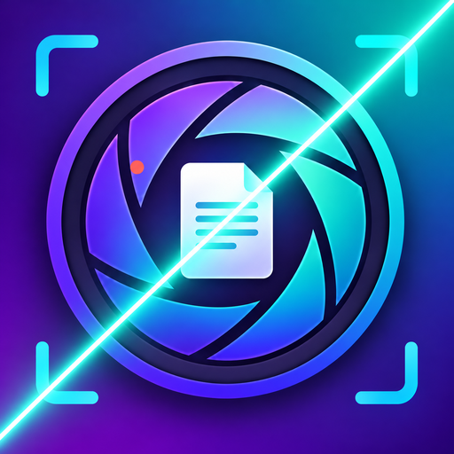

# FreeScan

<p align="center">
  
</p>

FreeScan 是一款基于开源项目 [FairScan](https://github.com/pynicolas/fairscan) 二次开发的 Android 文档扫描应用。它提供文档扫描、页面调整、PDF 导出和本地图片工具。

## 功能

- **文档扫描**：使用相机或导入相册图片，自动检测文档边缘并校正透视；可手动调整裁边、旋转页面和调整页面顺序。
- **图像处理**：提供彩色、灰度、黑白、提亮和文档增强等处理方式，并可调整去阴影。
- **PDF 页面编辑**：从“最近 PDF”打开文档后，可在 FreeScan 中调整页面、裁边和滤镜，再导出编辑后的文档。原 PDF 保持不变；导入时页面会转换为图像，因此不能直接编辑 PDF 内的文字对象。
- **证件扫描**：提供九种证件模板的取景预览，默认自动裁边，也可切换为手动裁边。
- **试卷擦除**：本地自动处理彩色笔迹，也可用画笔选择区域进行修复。
- **二维码/水印处理**：提供夸克二维码自动处理，并可通过区域选择补充需要修复的位置；支持 PDF 和图片。
- **导出与打印**：可将页面导出为 PDF 或 JPEG，并使用 Android 系统打印服务。

## 隐私

扫描图像和上述处理均在设备本地完成，不上传到云端。OCR 语言包可在设置中选择下载；下载后文本识别也在本地运行。应用不包含云端 AI 处理模块。

## 下载 APK

打开本仓库的 [Actions](https://github.com/tbslantian/FreeScan/actions)，选择最近一次成功的 **Android CI** 工作流，在 Artifacts 下载 `Freescan-APKs`。工作流构建的是按处理器架构拆分的 APK，请选择与设备匹配的文件；大多数现代 Android 手机使用 `arm64-v8a`。

## 从源码构建

需要 JDK 17 和 Android SDK Platform 36。首次构建需要网络来下载 Gradle 依赖；如果本地没有扫描分割模型，构建脚本也会自动下载该模型。

Windows PowerShell：

```powershell
git clone https://github.com/tbslantian/FreeScan.git
cd FreeScan
.\gradlew.bat :app:assembleDebug
```

构建 Release APK：

```powershell
.\gradlew.bat :app:assembleRelease
```

APK 输出在 `app/build/outputs/apk/`。Release 签名密钥和密码应配置在本机或 CI 的安全环境中，不要提交到仓库。`local.properties` 是本机 SDK 路径配置，也不应提交。

GitHub Actions 在推送到 `main` 后运行许可证检查、项目检查和 Release 构建。

## 技术栈

- [Kotlin](https://kotlinlang.org/) 与 [Jetpack Compose](https://developer.android.com/compose)：应用逻辑和界面
- [CameraX](https://developer.android.com/media/camera/camerax)：相机采集
- [LiteRT](https://ai.google.dev/edge/litert)：端侧文档边缘分割
- [OpenCV](https://opencv.org/)：图像几何校正和处理
- [Tesseract OCR](https://github.com/tesseract-ocr/tesseract)：本地文字识别
- [PdfBox-Android](https://github.com/TomRoush/PdfBox-Android)：PDF 生成与处理

## 致谢与许可

本项目基于 [FairScan](https://github.com/pynicolas/fairscan) 开发，并遵循 GNU GPL v3。详见 [LICENSE](LICENSE)。
