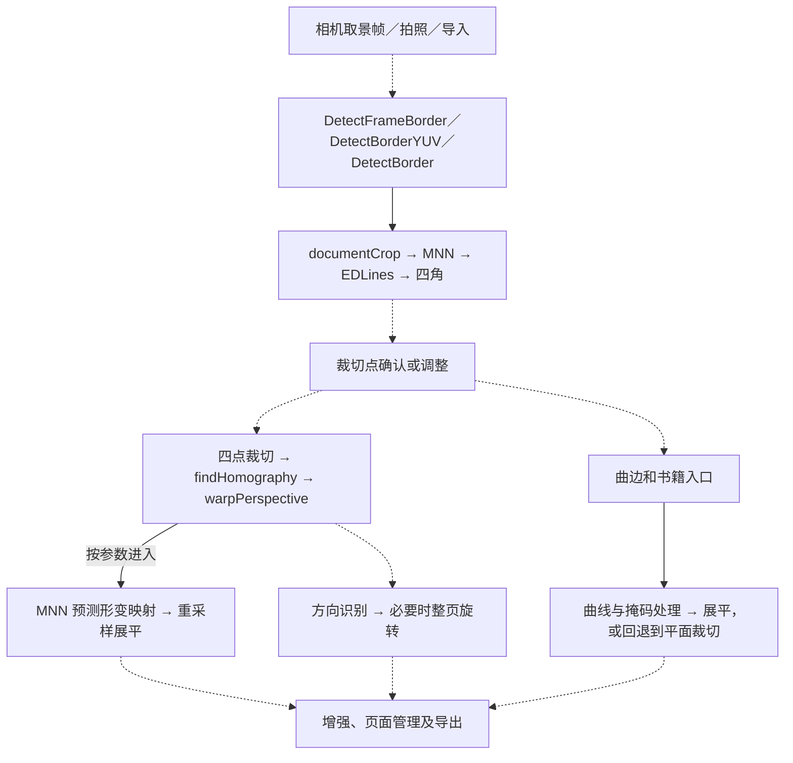

# 全能扫描王 Android 7.28.5 与 FreeScan 扫描流程对照

## 样本与证据

APK 声明包名 `com.intsig.camscanner`，版本 `7.28.5.2611030000`，版本代码 `72852`，minSdk 21，targetSdk 36。APK SHA-256 为 `a6b35e35680df0abb8b558f5802b63167d0905d37eaad6a2f7fc035cf6151ade`。

REA 的 Android 清单记录是 `ev_1c0d529a559248f1979cd15a9dcce391b5467bd2ad78b1749f57e75477c0ad9f`。外层 DEX 只有 6 个类，包括 4 个 `s.h.e.l.l` 类，另有 `assets/ijiami.dat`。完整的业务 Java 调用链无法从外层 DEX 还原。用 REA 枚举 ELF 导出，再用 ARM64 指令和 PLT 重定位核对函数间直接调用。核心 `libpagescanner.so` 的导出证据是 `ev_138cd2875cba74916463391961b746c9ac3109e9bd60d7546f1f822303a66010`，库 SHA-256 为 `cea4cbe6e1fd5569bfbd79cbf408a96dabb94a744602930f530dcb5262bac164`。

## 功能清单

依据 `main_page_scan_func_distribute_data.json`、`tool_page_v2.json`、`tool_page_v3.json`、`cs_list_more.json`、Manifest 和原生入口归类。清单覆盖上述证据可识别的功能。菜单项、声明和库函数的存在无法单独确认该设备上能否使用，或是否涉及联网和会员权限。

| 类别 | 可识别功能 |
| --- | --- |
| 扫描和输入 | 智能文档扫描、批量扫描、相册图片导入、外部文档导入、书籍扫描、翻页检测、双页分割、大幅面多图拼接、长图、水印相机、证件及学生证件扫描、证件照、拍 PPT、拍白板和手写板、二维码、拍照计数。 |
| 扫描后处理 | 取景找边、裁切、透视校正、曲边裁切、书页展平、页面方向识别和旋转、滤镜增强、去阴影、去模糊、去摩尔纹、书页手指处理、拼图、照片修复。 |
| OCR 和转换 | 单页及批量文字识别、拍照翻译、表格识别、公式识别、发票识别、拍图转 Word、文档转 Word／Excel／PPT、逐页转图片、转长图。 |
| 试卷和教育 | 拍试卷、试卷去手写、单拍错题、错题组卷。 |
| PDF 和文档管理 | PDF 预览和编辑、PDF 工具包、页面管理与调序、合并、提取、压缩、加密、复制和移动、电子签名、添加水印、AI 擦除、消除印记、证件复印件和证件卡包。 |
| 分享和归档 | 保存到相册、发送到电脑、邮件发送、打印、传真入口、文档备份和同步、云盘入口、设备迁移、搜索。 |
| 其他入口 | CSAI 文档入口、简历模板、创新实验室、打印设备入口、账号、会员及企业版入口。 |

## 扫描几何处理

下图按处理职责排列。实线表示已在原生指令中核对的内部关系，虚线表示依据界面和入口推定的业务连接。普通扫描中方向分类的默认触发条件及其与裁切的先后关系仍待确认。



| 环节 | 全能扫描王 APK 中的原生证据 | 当前安卓版 FreeScan |
| --- | --- | --- |
| 自动找边 | `DetectFrameBorder`、`DetectBorderYUV`、`DetectBorder` 均调用 `documentCrop`（`0xa8534`）。`cardCut`（`0xa7448`）在缩放及预处理后运行 MNN，随后执行 `findLines_EDLine`、候选四角处理和顺时针排序。`documentCrop` 还包含 ROI 分支、`SinglePageSet.addCurrentFrame` 和 `adjustCorners`。另有 `libscannercs.so` 的 `ScannerEngine` 路径，能调用 `DetectCardInVideo` 或 `DetectBoundLinesColorByModes`，入口优先级待确认。 | 预览与拍照分别使用本地 `DocDetect` 会话 0 和 1，共用 `v5.vaimlite` 与 `yolo_fp16.vaimlite` 资产。预览使用 `QuadStabilizer`。原生失败时用 LiteRT 分割掩码拟合四角，静态路径再尝试最小外接矩形。相册导入进入同一静态自动裁边路径。 |
| 裁切与透视 | `CropDewarpImagePos2`（`0x7e324`）检查输入点，再调用 `CropDewarpImagePos_new`（`0xae930`）。`transformCut`（`0xa9860`）求目标点及尺寸，以 `findHomography` 方法 0 求矩阵，再执行 `warpPerspective`。另有 `ScannerEngine.trimImageS → DewarpImagePlane` 平面路径。 | 主路径把四角映回原尺寸，调用 `DocDetect.runDocRectify`，再按边缘统计去暗框。分割回退和普通重处理走 `extractDocument`，根据相机参数或几何估计宽高，再执行 `getPerspectiveTransform → warpPerspective`。手动裁边使用四角。 |
| 整页方向 | `getDocDirectionPtr`（`0x8303c`）进入 `direction::get_doc_direction`（`0x14b7a4`）。512×512 MNN 模型比较 5 个分数，阈值由调用方传入，低于阈值时返回 -1。`rotate_img`（`0x14bb64`）只对 1、2、3 做三种直角旋转，分别为逆时针 90°、180°、顺时针 90°。第 5 类的业务含义未确认。 | 拍照根据采集方向旋转，也支持手动旋转。普通扫描主链未见通过文档内容识别整页方向的模型。 |
| 小角度文字行纠偏 | 发现 `RotateProcessImage` 可执行仿射旋转。可直接定位的 `HoughLinesStandard` 调用在 `bookSplitLRBoundary`。已核对的方向识别函数未见以文字行估算小角度的调用。 | `deskewTextLines` 在单应裁切后灰度化，执行 Canny、`HoughLinesP`，取接近水平线段的中位角，满足 0.35°–4° 时用 `warpAffine` 纠正。拍照原生裁切成功后的 `alreadyRectified` 分支直接增强，跳过本函数；分割回退取得有效四角且滤镜非原图时可执行。编辑重处理单独走 `extractDocument`。 |
| 曲面展平 | 平面裁切入口存在调用 `dewarp_process_new`（`0xbc9d4`）的分支，`get_warp_mat` 用 MNN 得到形变数据。曲边入口 `CurveCropDewarpImagePosNew`（`0xc38e8`）计算曲边并以 IoU 判断，进入带掩码的映射或回退到普通裁切。书籍还存在 `ScanImgPNew → bookSplitLRBoundary_new` 以及 `DewarpImgP → BookCropDewarpImagePos`。 | 现有扫描使用四点单应变换和整图旋转。滤镜中的 `flattenPageIllumination` 处理纸面亮度，扫描主链未见独立的曲面像素重映射。 |

## 已提取的模型

四段数据都来自 APK 内的 ARM64 `libpagescanner.so`，由初始化函数以地址和长度传给 MNN。按公开格式解析了网络、算子表和输入声明。仅做了静态格式检查，尚未执行推理或验证成片。

| 用途 | 库内偏移 | 字节数 | 输入 → 输出 | 算子数 |
| --- | ---: | ---: | --- | ---: |
| 页面边缘 | `0x3ce940` | 1,584,816 | `input` [1,3,240,240] → `output` | 450 |
| 整页方向 | `0xa37198` | 1,063,348 | `data` [1,3,512,512] → `175` | 37 |
| 展平 A | `0x551c60` | 847,392 | `input` [1,3,240,240] → `output` | 880 |
| 展平 B | `0x620a80` | 1,584,744 | `input` [1,3,240,240] → `output` | 449 |

技术来源为 APK 的原生指令、[EDLines 原论文](https://doi.org/10.1016/j.patrec.2011.06.001)、[MNN 网络格式](https://github.com/alibaba/MNN/blob/master/schema/default/MNN.fbs)。FreeScan 对照点见 [CameraViewModel](../app/src/main/java/org/freescan/app/ui/screens/camera/CameraViewModel.kt)、[LocalDocumentScanner](../app/src/main/java/org/freescan/app/domain/LocalDocumentScanner.kt)、[ImageProcessor](../app/src/main/java/org/freescan/app/platform/ImageProcessor.kt) 和 [DocumentDetection](../imageprocessing/src/main/java/org/freescan/imageprocessing/DocumentDetection.kt)。

## FreeScan 接入与构建

对照表记录了接入前的实现。[CamScannerGeometry](../app/src/main/java/org/freescan/app/domain/CamScannerGeometry.kt) 在参考库可用时优先处理相机预览、拍照及相册的自动裁边。预览与静态图片使用独立找边会话。静态图片先调用曲边裁切接口，由原生库按曲边和四角的匹配程度选择展平或常规裁切，随后运行页面方向模型。参考 APK 的默认方向阈值未恢复，FreeScan 采用 0.75。手动裁切与 OpenCV 回退路径使用 `findHomography`，保留原有的输出尺寸估计。

参考 APK 只包含 arm64 库。本地构建以 Gradle 参数指定该 APK，校验 SHA-256 后提取 `libpagescanner.so`、`libMNN.so` 和 `libopencv.so` 到构建目录。常规构建和其他架构使用现有找边与静态处理路径。扫描库和内嵌权重留在本地构建产物中。

```powershell
.\gradlew.bat :app:assembleRelease "-PCAMSCANNER_REFERENCE_APK=C:/Users/tbsla/Downloads/110_63e887f3fc337ed179e5d5ba82ef178d.apk"
```

四个模型已用桌面 MNN 验证能产生有限输出，方向模型通过了四种合成旋转样例。Android JNI、实时速度和实际书页效果待真机验证。拍照或导入后可查看 `FreeScanCamScanner` 标签下的 `Reference geometry produced`，以确认该页由参考链处理。

## 滤镜接入

APK 的 `image_enhance_menu_7`（`0x7f0c0469`）依次声明去阴影、原图、增亮、增强锐化、高清入口、灰度、黑白和省墨。新版动态资源中另有反色。去手写和去水印也出现在新版资源中，独立工具栏同时包含擦除与消除印记入口。AI 高清文本声明需要开启云同步。

| FreeScan 滤镜 | 技术来源与实现 |
| --- | --- |
| 去阴影、智能高清 | `libmagicenhancer.so` 的 `deshadowFileNew`（`0x13090`）模式 1 和 3。模式 1 使用 MNN 光照估计后锐化。模式 3 先判断文档类型，再选择增强模型。参考 APK 构建提取此库及 `libncnn.so`、`libCVNN.so`。普通构建使用局部光照估计和 Retinex。 |
| 原图 | 保留裁切后的原始像素。 |
| 增亮 | 根据 `libscannercs.so` 模式 15 的高百分位直方图和色阶曲线重写。 |
| 增强锐化 | 重写 `libmagicenhancer.so` 模式 2 的逐像素颜色增强和随图像尺寸变化的锐化。 |
| 灰度、反色 | 采用 `ScannerEngine` 模式 10 和 51 观察到的整数亮度系数。反色保留负片映射，省略模式 51 的前置处理。 |
| 黑白、省墨 | 黑白复用模式 11／16 的纸底归一化和色阶曲线，底色估计使用形态学闭运算。省墨采用模式 19 末端的色阶曲线，沿用 FreeScan 的光照预处理。 |

外层 DEX 和 AOT 资源只能验证菜单和原生算子分别存在。上述界面标签与原生算子的配对是 FreeScan 的实现选择。参考库成功应用去阴影或智能高清时，`FreeScanScanFilters` 会记录 `Native enhancement applied`。自动是 FreeScan 的默认滤镜选择策略。
