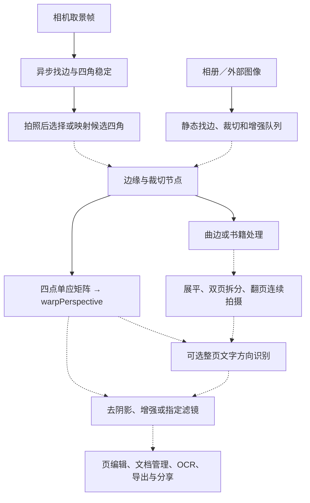

# 扫描全能王 iOS 7.28.5 与 FreeScan iOS 对照

下方 FreeScan 对照表记录迁移前的基线。当前接入方式与构建步骤见 [FreeScan iOS 扫描迁移](../ios/porting/CAMSCANNER_IOS_PORT.md)。

## 样本和证据

| 项目 | 实测或声明值 |
| --- | --- |
| 文件 | `CamScanner-IPAOMTK.COM.ipa`，200,445,119 字节 |
| 应用 | 扫描全能王，`com.intsig.CamScannerLite`，版本 `7.28.5`，构建 `7.28.5.2610302009` |
| 设备声明 | ARM64，最低 iOS 15.0，`UIDeviceFamily=[1]` |
| IPA SHA-256 | `8260c3a19f99620242b06a28611b00fbc5a80ec9cd54b38623895a55d8cca550` |
| 主程序 | `Payload/CamScanner_Lite.app/CamScanner_Lite`，SHA-256 `5a6bc50ada550080eaa174ed9e9f95454459a3f7e31031844f8383d752b15eb5` |
| REA 归档证据 | `ev_d5bc2966fe5fa74c1b73fbd8c786080323f5e27a8fec584bc4e5fbbfe6186bdc`，5,145 个文件条目 |
| FreeScan 对照 | 当前仓库 `M:\1\Freescan\ios`，Xcode 目标声明 iOS 17.0+、iPhone 和 iPad。独立目录 `M:\1\ios` 是较早副本。 |

主程序加载 `App.framework` 与 `Flutter.framework`。包内还有 `Frameworks/CamScanner.dylib`、`Frameworks/blatantsPatch.dylib` 和 `IPAOMTKWelcome-Blatant.dylib`，主程序的 Mach-O 也有对应加载项。本文将此 IPA 视为经过重打包的样本，扫描链主要以应用主程序中的 Objective-C 方法表、ARM64 指令、应用资源和模型字节为依据。REA 用于归档核验，Mach-O 的深入检查以本地解析和反汇编补充。功能入口、会员或云端提示均来自静态证据，地区、账户、服务可用性和实机成片未验证。

## 包内可识别功能

工具中心各地区、教育版本和新旧配置的并集如下。中文资源还提供部分未出现在固定工具中心里的入口。

| 模块 | IPA 内可识别的功能 |
| --- | --- |
| 扫描与导入 | 智能扫描、文件扫描、单页、批量、自动拍照、自动裁边、重拍、相册和外部文档导入、水印相机、卷动截图、相册文档雷达、大幅面多帧拼接、锁屏快捷拍摄 |
| 证件与拍摄模式 | 证件和学生证件、身份证、护照、银行卡、户口本、房产证、驾驶证、行驶证、营业执照、证件照、书籍、PPT、白板、手写板、发票、银行流水、拍照计数、二维码和条码识别 |
| 书籍与页面处理 | 单页／双页扫描、左右页拆分、弯曲书页展平、连续翻页拍摄、四角裁切、旋转、文字方向自动旋转、滤镜、去阴影、去手指和摩尔纹的入口或说明、照片高清修复、文档变高清 |
| 识别与转换 | 提取文字、OCR、拍照翻译、表格还原／识别、公式识别、拍图转 Word、拍图转 PPT、转 Excel、图片、长图、Markdown、Markdown 转 PDF、网页转长图／PDF、带原版式的文字编辑入口 |
| 教育与 AI | 扫试卷、去手写、单拍错题、跨页或手动裁题、错题重排、AI 搜题、AI 擦除、去除印记、AI 测量、AI PPT、AI 文档问答／改写／总结、AI 文档检索和 AIGC 检测 |
| PDF、文档和隐私 | PDF 编辑、合并、提取、重排、压缩、加密、添加水印、注释、笔迹和印记擦除、插入文字、签名、印章与骑缝章、文档标题／备注、区域或文字脱敏、电子存证、归档和收藏 |
| 分享、自动化与打印 | 系统分享、邮件、云同步和上传、电脑编辑、协作、自动上传或命名工作流、AirPrint、蓝牙和 Wi-Fi 打印、硬件扫描仪配对、Siri、部分地区传真 |
| 其他工具 | 简历模板、设备商城、实验室、3D 物体拍摄与重建／导出／AR 预览、会员和订阅、小组件、推送、动态计时 |

主要来源为 `main_tool_local_config.json`、`cs_app_tool_center_data*.json`、`toolcenter_*.json`、`new_more_config_*_convert2pic.json`、`zh-Hans.lproj/Localizable.strings` 及 `AppShortcuts.strings`。样本包含 18 个 `.appex` 的 `Info.plist` 声明，涵盖锁屏拍摄、分享／收藏／归档、OCR、打印、格式转换、网页转换、滚动截图、小组件和通知等入口。快捷指令别名本身不证明各证件使用不同算法。

扫描滤镜资源有 **去阴影、原图、增亮、增强锐化、智能高清、灰度、黑白、省墨、反色、去手写、去水印**，对应 `cs_684_filter_*` 和 `cn_filter_page_*.webp`。Flutter 内还可找到八个核心滤镜缩略图，资源未确定实际菜单排序。原生有独立的多滤镜、去阴影、局部超级增强节点。`cs_665_hd_06` 明确描述「文档变高清」上传图片，`cs_727_scanner_14` 提到云端滤镜和转换，`cs_760_ai_magic` 另有「AI 高清」名称。这些证据不足以判定每个智能高清入口的联网条件。普通二维码入口的配置对应识别。

## 扫描流程

下图实线表示有直接方法、指令或配置锚点，虚线表示各模块的业务连接或条件分支。全部页面的统一执行顺序未能从这份样本中确定。

| 环节 | 扫描全能王 iOS 7.28.5 | 当前 FreeScan iOS |
| --- | --- | --- |
| 取景和拍后四角 | `CSCameraAutoCropMask.updateMaskWithSampleBuffer` 有独立队列，包含稳定、有效性和面积状态。`newSuitableFoundBordersWithOrignalImage` 调用 `mnnFoundBorders` 和 `photoBorderPointsFromPortraitBuffer`，证明部分拍后路径可以复用取景候选。资源另有稳住设备后自动拍照、连续翻页的说明。 | AVFoundation 取景，节流检测并平滑四角，支持连拍三帧择优。成片按方向元数据正向化，拍照与相册共用 `prepareScan`，静态图重新找边。见 [CameraCapture.swift](../ios/CameraCapture.swift#L242) 和 [FreeScanApp.swift](../ios/FreeScanApp.swift#L301)。 |
| 自动找边 | `CSDetectEdgeNode` 有旧库、新库、新 PageScan 分支。新分支取 `docCropNewContext`，进入原生例程后写入四角。新找边上下文引用与 Android 版一致的 MNN 边缘模型。EDLines 已在同版 Android 样本验证，iOS 找边例程的线段提取实现尚未独立定位。 | OpenCV DNN 跑 `ScanEdgeModel.onnx` 的 256×256 HED 边缘图，阈值化后用 5×5 闭运算、轮廓、凸包及多边形拟合选四角。失败时尝试 Vision 文档分割、Vision 矩形检测。见 [DocumentEdgeCore.hpp](../ios/DocumentEdgeCore.hpp#L56) 和 [ImagePipeline.swift](../ios/ImagePipeline.swift#L133)。 |
| 裁切与透视 | `CSCropEdgeNode` 分发到旧、大图、新、曲边等路径。新 PageScan 路径已追到 OpenCV `findHomography → warpPerspective`，书页裁切也有调用同一透视例程的分支。 | 四点 `getPerspectiveTransform → warpPerspective`，线性插值及白色边界，并支持手动拖动四角。见 [DocumentGeometryCore.hpp](../ios/DocumentGeometryCore.hpp#L47)。 |
| 整页方向与文字行纠偏 | 有独立的文字方向开关。识别包装器接收阈值并初始化方向模型。原生旋转只处理方向 ID 1、2、3，书页包装器把它们分别换算为顺时针 270°、180°、90°。普通模式的运行阈值和其他模型输出含义尚未核对，小角度文字行纠偏也尚未在已追踪路径中定位。 | 支持设备方向与手动旋转。透视裁切成功后可对字形基线取中位角，失败时用 Canny 与 Hough 作后备，再在 0.35°–4° 范围用 `warpAffine` 拉正。编辑器也提供独立按钮。源码中未发现基于文字内容的整页直角分类。见 [DeskewCore.hpp](../ios/DeskewCore.hpp#L63)。 |
| 曲面展平与书籍 | 有曲边上下文、书页专用裁切、双页拆分接口及翻页识别。新展平上下文使用与 Android 相同的一个 MNN 形变模型。普通文档触发曲面处理的阈值、具体重采样顺序尚未完全核对。 | 主扫描路径使用平面四点变换和仿射旋转，当前源码中未发现独立书脊拆页、曲面形变图重采样或翻页自动拍照。 |
| 滤镜与去阴影 | 独立处理节点包含去阴影、颜色增强、本地超级增强、多滤镜。主二进制含已匹配的 MNN 去阴影模型，且已追到本地颜色增强／超级增强路径引用其相关初始化。独立去阴影节点的直接调用链走另一组入口，尚未证实两个入口使用同一模型。 | 自动、原图、彩色、灰度、黑白、局部提亮、文档增强、增强灰度、柔和增强。使用局部纸底估计、颜色校正、Retinex、Sauvola 和锐化等，去阴影可单独开关。当前 iOS 滤镜定义没有独立智能高清或省墨。见 [Models.swift](../ios/Models.swift#L15) 和 [DocumentFilterCore.hpp](../ios/DocumentFilterCore.hpp#L230)。 |
| 页编辑、OCR 和输出 | 有批量增强、PDF 工具、文字识别、Office／Markdown 转换及云端工具等入口，实际可用性与账号地区有关。 | 多页编辑、草稿、文档库、证件九模板、二维码水印修复、彩笔／手动试卷擦除。PDF／JPEG 分享、保存与 AirPrint，OCR 默认关闭，按需用 Apple Vision 或本地 Tesseract，可导出可搜索 PDF。导入 PDF 进行图像编辑时先用 PDFKit 栅格化。见 [FreeScanApp.swift](../ios/FreeScanApp.swift#L47) 和 [PDFServices.swift](../ios/PDFServices.swift#L51)。 |

## 原生证据定位

地址是主程序 Mach-O 的 ARM64 虚拟地址，模型位置是主程序内的文件偏移。

| 证据 | 地址或文件偏移 |
| --- | --- |
| 取景候选用于拍后四角 | `CSCameraAutoCropMask newSuitableFoundBordersWithOrignalImage:` 在 `0x10090abf8` |
| 新 PageScan 找边 | `0x1012f55e0 → 0x1054ad610`，返回后调用 `setDetectedCornerPoints:` |
| 普通透视链 | `0x1012f424c → 0x1054b18b4 → 0x1054ae71c`。末级在 `0x1054ae82c` 调用 `findHomography`，在 `0x1054ae8b0` 调用 `warpPerspective`。 |
| 曲边、书页与双页 | `CSCropEdgeNode` 曲边入口 `0x1012f45b0`，`WB_OCWrapper` 书页入口 `0x101e555a8`，`CSIEnginePigeonImplement` 双页拆分入口 `0x1012a5790` |
| 整页方向 | `CSImageDirectionUtil` 的 `0x1009ad8c8` 调用阈值版包装器，`WB_OCWrapper` 的 `0x101e5eb60` 调用 `0x105595d58` 加载方向模型。原生旋转分支在 `0x1055960d0`，书页角度换算在 `0x1005f4594`。 |
| 去阴影、传统滤镜、本地超级增强 | `CSRemoveShadowBitmapNode` `0x1012f9390`、`CSMultiEnhanceBitmapNode` `0x1012f8284`、`CSLocalSuperEnhanceNode` `0x1012f74a4` |

以下模型在主程序内的完整字节分别与此前 Android 7.28.5 样本提取结果一致。匹配范围是模型数据，iOS 和 Android 的调用条件仍分别核对。此前 Android 的另一版展平模型没有得到同样的匹配。

| 模型 | 偏移 | 字节数 | 对应主程序引用 |
| --- | ---: | ---: | --- |
| 页面边缘 | `0x91bbb20` | 1,584,816 | `0x1054b49c8` |
| 曲面展平 B | `0x941471c` | 1,584,744 | `0x1054cef68` |
| 整页方向 | `0x972ba2c` | 1,063,348 | `0x105595db4` |
| 去阴影光照估计 | `0x990d050` | 926,496 | `0x1055a1454` 等 |
| 旧版扫描增强 | `0x9b7c038` | 61,224 | `0x1055a496c` |

参考 [同版 Android 扫描分析](camscanner-android-scan-analysis.md)。IPA 静态证据能确定已定位的入口、模型和部分调用链。效果、速度、当前账号能见到的菜单以及参数默认值仍需设备观测。
